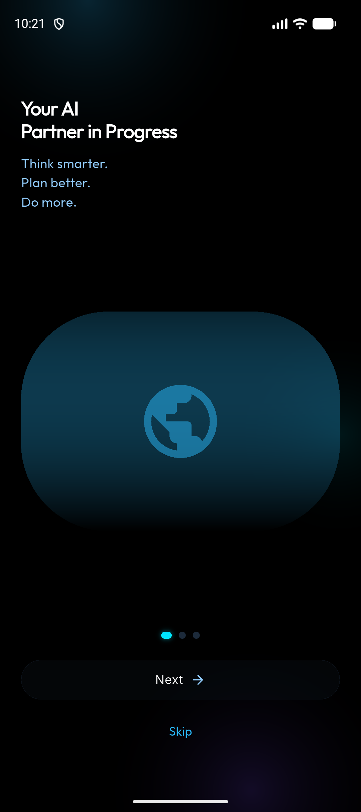
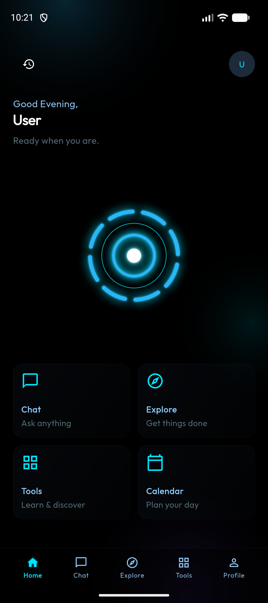
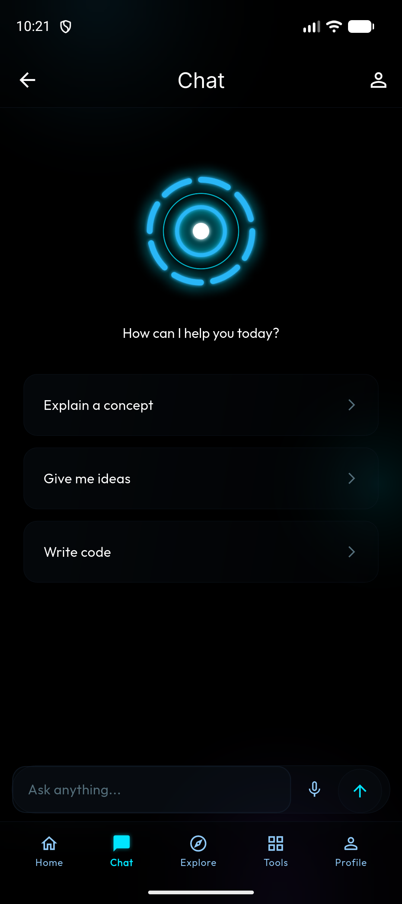
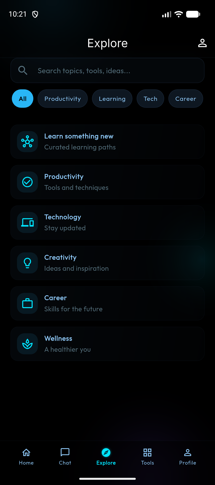
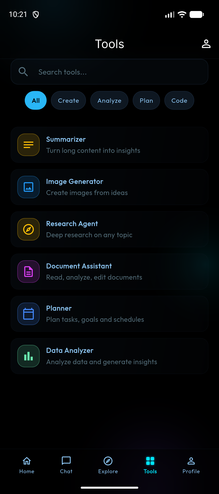
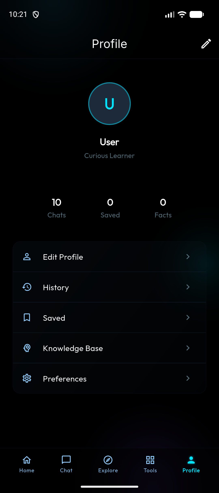
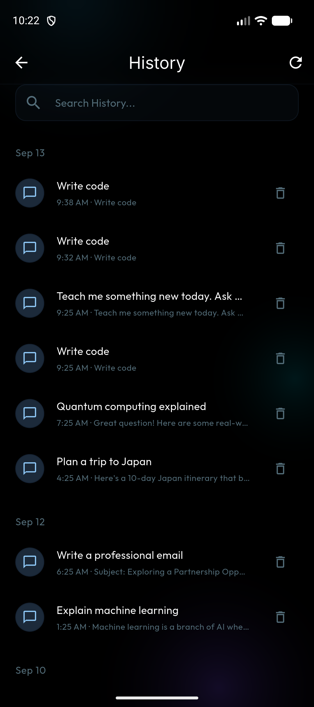
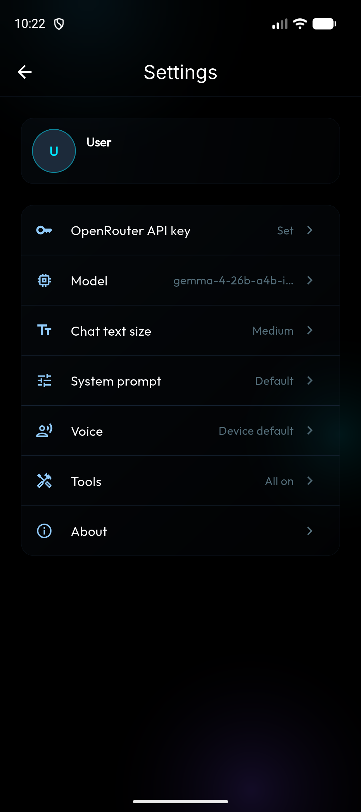

# JARVIS

A personal AI assistant for Android, built with Flutter. It chats, searches the web, sets timers, opens apps, reads your calendar, and listens and speaks on-device — and it costs nothing to run.

**Zero cost by design.** JARVIS only talks to free models on [OpenRouter](https://openrouter.ai). The model picker lists only models priced at exactly $0, and every request is checked again before it is sent — a paid model is refused locally, so no credits can ever be spent.

## Screenshots

<table>
  <tr>
    <td align="center"><br><sub>Onboarding</sub></td>
    <td align="center"><br><sub>Home</sub></td>
    <td align="center"><br><sub>Chat</sub></td>
    <td align="center"><br><sub>Explore</sub></td>
  </tr>
  <tr>
    <td align="center"><br><sub>Tools</sub></td>
    <td align="center"><br><sub>Profile</sub></td>
    <td align="center"><br><sub>History</sub></td>
    <td align="center"><br><sub>Settings</sub></td>
  </tr>
</table>

## Features

- **Streaming chat** with free open models via OpenRouter, rendered with markdown (bold, lists, inline code, code blocks).
- **Tool use** — the model can call on-device actions (see below) and chain up to four rounds per reply.
- **Voice mode** — on-device speech-to-text and text-to-speech; pick any installed voice.
- **Memory** — say *"remember that …"* and the fact is saved and used in future conversations. View and delete facts in the Knowledge Base.
- **History & Saved** — conversations persist across restarts, grouped by day and searchable; saved items have their own screen.
- **Calendar** — browse your device calendar by day.
- **Customisation** — chat text size, custom system prompt, TTS voice, model choice, and per-tool on/off switches.
- **Works offline where it can** — fonts are bundled; speech recognition and TTS run on the device.

## Tools

The assistant can call these during a conversation. Each can be switched off in **Settings → Tools**.

| Tool | What it does |
|------|--------------|
| `web_search` | Searches DuckDuckGo, falling back to Wikipedia. Results are passed to the model as untrusted reference material. |
| `current_datetime` | Current date, time and time zone. |
| `read_clipboard` | Reads the clipboard text. |
| `set_timer` | Sets a countdown timer or alarm in the Clock app. |
| `open_app` | Opens an installed app by common name. |
| `check_battery` | Battery level and charging state. |
| `send_sms` | Opens the SMS app with a drafted message — you press send. |
| `make_call` | Opens the dialer with a number — you place the call. |
| `manage_calendar` | Lists today's events or adds an event to your calendar. |

The **Tools** tab in the app is separate: its cards (Summarizer, Research Agent, Planner, …) are starter prompts that open a chat pre-filled for that task.

## Getting started

### Requirements

- [Flutter](https://docs.flutter.dev/get-started/install) 3.x (developed on 3.44)
- Android SDK, and an Android device or emulator running Android 7.0 (API 24) or later
- A free [OpenRouter API key](https://openrouter.ai/keys) — no payment details needed for free models

### 1. Add your API key

Copy the template, then paste your key between the quotes in `lib/secrets.dart`:

```bash
cp lib/secrets.example.dart lib/secrets.dart
```

`lib/secrets.dart` is gitignored, so the key never gets committed. The app does not compile without this file, but the key inside it can stay empty.

Alternatively, leave the key empty and paste it into **Settings → OpenRouter API key** on the device. A key saved there is stored in the Android Keystore and takes priority over `secrets.dart`. Without any key, the app runs on canned demo replies.

### 2. Run

```bash
flutter pub get
flutter run
```

### 3. Build an APK to sideload

```bash
flutter build apk --release --target-platform android-arm64
```

The APK is written to `build/app/outputs/flutter-apk/app-release.apk` (~21 MB). Copy it to your phone and install it, allowing installs from unknown sources when asked.

**Signing:** if `android/key.properties` exists, release builds are signed with the keystore it points to ([Flutter's signing guide](https://docs.flutter.dev/deployment/android#sign-the-app)). Without it, they fall back to the debug key — fine for sideloading, not for the Play Store. Keystores and `key.properties` are gitignored; never publish them.

> A key compiled into `lib/secrets.dart` ships inside the APK and can be extracted from it. Don't share an APK built with your key — leave the file empty and enter the key in Settings instead.

## Permissions

| Permission | Used for |
|------------|----------|
| `INTERNET` | OpenRouter requests and web search |
| `RECORD_AUDIO` | Voice input |
| `READ_CALENDAR` / `WRITE_CALENDAR` | The calendar screen and `manage_calendar` tool (requested at first use) |
| `SET_ALARM` | The `set_timer` tool |

## Privacy

- Conversations, memories, profile and preferences are stored only on the device, encrypted with `flutter_secure_storage` (Android Keystore).
- Messages are sent to OpenRouter and the selected model provider to generate replies. Free models on OpenRouter may log prompts — avoid sending anything sensitive.
- Speech recognition and text-to-speech run on the device.

## Project structure

```
lib/
├── main.dart                  # Startup: loads key, model, memories, preferences
├── core/
│   ├── routing/               # GoRouter routes
│   ├── theme/                 # Colours, typography, spacing
│   └── widgets/               # Shared UI (glass widgets, orb, shell)
├── features/                  # One folder per screen
│   ├── onboarding/  home/  chat/  voice/  explore/  tools/
│   ├── calendar/  knowledge/  history/  saved/  profile/  settings/
├── models/                    # Conversation, message, profile, saved item
├── repositories/
│   ├── openrouter_repository.dart  # Streaming chat, tool-call loop, free-model guard
│   ├── tools.dart                  # Tool definitions
│   ├── web_search.dart             # DuckDuckGo + Wikipedia search
│   └── *_store.dart                # Encrypted on-device persistence
└── services/providers.dart    # Riverpod providers and chat/voice state
android/app/src/main/kotlin/   # Platform channel for timers, alarms and app launch
```

**Stack:** Flutter · Riverpod · GoRouter · flutter_secure_storage · speech_to_text · flutter_tts · device_calendar · url_launcher · battery_plus · Google Fonts (Outfit, Fira Code — bundled)

## Tests

```bash
flutter test
```

The tests cover the free-model filter and send-time guard, markdown rendering, and web search parsing.

## Credits

Bundled fonts — Inter, Outfit and Fira Code — are licensed under the SIL Open Font License; the licence texts are in `assets/fonts/` and `assets/google_fonts/`.

## License

[MIT](LICENSE) © 2026 Harishram
